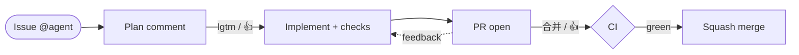

# gh-issue-killer

[简体中文](README.zh-CN.md)

Watch GitHub issues and let a coding agent (opencode, Claude Code, or Codex)
plan → implement → test → screenshot → open a PR → squash-merge them, driven
entirely from issue comments.

## Workflow



Failing checks are repaired automatically; only an exhausted budget parks the
issue as `blocked`. Closing it cancels the task and closes the PR; reopening
resumes it.

## What it solves

- **Issues pile up untouched.** Reading each one, planning, implementing and
  verifying takes whole afternoons, so PRs sit around.
- **Someone has to babysit checks and conflicts.** A red CI, a job stuck on a
  retired runner or a branch conflict means manual digging and manual fixes.
- **An agent loose in your checkout is risky.** A failed or interrupted run
  leaves your working tree dirty.
- **One slow repo blocks the rest.** A slow CI occupies every slot, so you end
  up running one daemon per repository.

## What it does

- **Plan first.** A mention or assignment posts a plan comment; nothing is
  written until you approve. Issues labelled `bug` skip the plan: reproduce,
  fix, add a regression test.
- **One worktree per issue.** Its own branch and bot-authored commits, so your
  working clone is never touched; a restart resumes it.
- **Verifies and repairs CI itself.** The coding agent writes the commands that
  prove its work (`checks.json`), the daemon runs them and hands failures back;
  a red or stuck PR check goes back to the agent too, and only an exhausted
  budget parks the issue as `blocked`. A task parked by failed checks resumes by
  itself once the PR's checks turn green.
- **Driven by one comment.** Approve, change a PR, resolve conflicts, merge or
  cancel with a comment or 👍 — on any PR in a watched repo, not only its own.
- **Multi-repo, no cross-blocking.** Each repository has its own agent, model,
  approvers and queues, and CI runs on a separate queue, so one slow repo never
  blocks another.
- **One static binary.** Outbound HTTPS only; at runtime it needs `git`, one
  coding-agent CLI and a shell (`/bin/sh`, `cmd` on Windows). Releases ship
  macOS, Linux and Windows builds.

Set `webPort` for the live dashboard: per-repo queues and parallel meters (the
PLAN/WORK limits apply per project), stage progress, PRs, checks, screenshots
and the daemon log, with plans rendered as markdown. The board follows the
system theme or can be pinned to light/dark, the interface switches between
Chinese and English and links back to this repository, tasks can be filtered by
project or free text or hide finished/cancelled work, the console colours the
log by level, and the header counts the tasks waiting for you (approval, merge
or unblock).

### Desktop app

No terminal needed: download the desktop bundle from
[Releases](https://github.com/uiautodev/gh-issue-killer/releases) (macOS `.app`,
Linux tarball/AppImage, Windows zip) and launch it. The window is the same
dashboard, with a **Settings** panel for repos, coding agent, model, proxy and
the release mirror, plus a version card that checks and installs updates. On
first run it opens on the settings panel; closing the window stops the engine,
so nothing is left in the background. Details:
[DEPLOY.md](DEPLOY.md#31-desktop-app--optional).

## Install with a coding agent

Give Claude Code, Codex or opencode this repository and paste this into it:

```text
Deploy gh-issue-killer on this machine by following DEPLOY.md §0–§5 (skip §6
unless I ask for boot persistence). Work autonomously and ask at most one
question, only if a value truly cannot be inferred.

Defaults, use them without confirming:
- repos: the origin remote of this git checkout; if there is none, ask me once
- approver: my GitHub login from `gh api user --jq .login`
- codingAgent: the first of opencode, claude, codex found on PATH
- model: the CLI default (leave it empty)
- proxy: $https_proxy or $ALL_PROXY if set, otherwise none
- binary: ~/.local/bin/gh-issue-killer, config: ~/.config/gh-issue-killer/config.json

Do not create GitHub accounts or tokens. Granting this bot push/admin on the
repos above with my gh is allowed (DEPLOY.md §2). If no gh-agent credential
exists (~/.config/gh-agent or $GH_AGENT_TOKEN), stop after printing the exact
single command I must run, then continue from §2.

Finish with the §10 checks and paste the status lines. Do not ask me to confirm
steps you can verify yourself.
```

The agent follows [DEPLOY.md](DEPLOY.md): it installs the binary, creates the
dedicated `gh-agent` wrapper if needed, writes the config, runs the smoke test,
starts the daemon and reports the status lines. It stops only when it needs a
bot token, which only you can log in for.

**Manual install.** Requirements: Go 1.27+, `git`, one coding-agent CLI, and a
GitHub bot account with a token (`GH_AGENT_TOKEN` or
`~/.config/gh-agent/hosts.yml`).

```bash
go build -o bin/gh-issue-killer ./cmd/gh-issue-killer
./bin/gh-issue-killer -init      # wizard: repos, agent, approvers, proxy
./bin/gh-issue-killer            # background daemon
./bin/gh-issue-killer -status    # pid, config, log and state paths
```

Full deployment, operations, upgrades and troubleshooting:
[DEPLOY.md](DEPLOY.md). Internals, the state machine, queues and the CI gate:
[DEVELOP.md](DEVELOP.md); contributor/agent rules: [AGENTS.md](AGENTS.md).

## Daily use

Open an issue that mentions the bot (or assign it to the bot). Then:

| comment | effect |
| --- | --- |
| `@agent lgtm`, `@agent continue`, `@agent 继续` | approve the plan (or retry after blocked) |
| `@agent 合并`, `@agent merge`, `@agent ship` | squash merge the PR, close issue + PR, clean the worktree |
| `@agent review`, `@agent cr` (on a pull request) | review that PR's diff and post a summary plus inline findings |
| `@agent <instruction>` (on a pull request) | change that PR: the agent edits the branch, runs the checks and pushes to the PR head |
| `@agent apply`, `@agent 应用` (on a pull request) | apply the findings of the latest bot review without running a new one |
| `@agent 合并`, `@agent merge` (on a pull request) | resolve conflicts, run the checks/CI and squash-merge that PR |
| `@agent cancel`, `@agent stop`, `@agent 停止` | abort the current task |
| 👍 on the plan comment | same as `@agent lgtm` |
| 👍 on the PR-announcement comment | same as `@agent 合并` |
| 👍 on the bot's “Review 已提交” comment | apply that review's findings to the PR (edit + push) |

Commands must come from an approver, mention the agent, and be the **whole
comment**. Approval words, status labels and review rules live in
[DEPLOY.md](DEPLOY.md) and [DEVELOP.md](DEVELOP.md).

## Configuration

```bash
./bin/gh-issue-killer -init      # wizard: repos, agent, approvers, proxy
```

`-init` writes the config for you; a hand-written JSON uses the same `repos` /
`codingAgent` / `approvers` / `proxy` keys. Full reference (`language`,
`webPort`, `updateProxy`, per-repo overrides, live reload):
[DEPLOY.md](DEPLOY.md#41-configuration-reference). With `selfUpdate` on, the
daemon installs new releases itself (checksums verified, `updateProxy` mirror
when github.com is unreachable); the dashboard can also check and install on
demand.

## Development

```bash
go test ./...
go build -o bin/gh-issue-killer ./cmd/gh-issue-killer
```

Internals and releases (a `v*` tag drives the workflow) are in
[DEVELOP.md](DEVELOP.md); contributor rules are in [AGENTS.md](AGENTS.md).

## License
[MIT](LICENSE)
