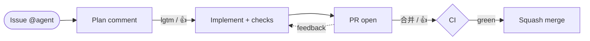
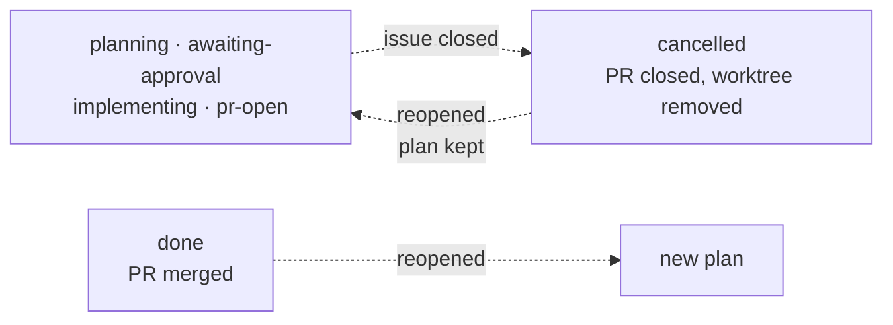

# gh-issue-killer

[简体中文](README.zh-CN.md)

Watch GitHub issues and let a coding agent (opencode, Claude Code, or Codex)
plan → implement → test → screenshot → open a PR → squash-merge them, driven
entirely from issue comments.

## Workflow



Failing local checks and failing PR checks both get `maxFixRounds` repair rounds.
A PR check that is red or stuck (a job queued on a retired runner, a Python
version the image no longer has) is handed back to the agent, which fixes the
workflow or the code in the same PR instead of parking the task; only when the
rounds are exhausted is the issue parked as `blocked`, and retrying with
`@agent 合并` picks it up again.

Closing the issue at any stage cancels the task and closes the PR; reopening
resumes it. A merged issue that is reopened starts a fresh plan.



## What it does

- **Plan first.** A mention (or assignment) produces an implementation plan as
  a comment, with an isolated planning worktree; nothing is written until you
  approve.
- **Bugs skip the plan.** An issue labelled `bug` goes straight to the coding
  stage: the agent first tries to reproduce it, fixes it with a regression test
  when it exists, and reports back without a PR when it cannot.
- **Isolated implementation.** Each issue gets its own git worktree and branch;
  your working clone is never touched. Commits are authored as the bot.
- **Checks and screenshots.** The coding agent writes the commands that prove
  its work (`checks.json`); the daemon runs them, gives the agent up to
  `maxFixRounds` repair rounds, and only then pushes. UI changes come with
  before/after screenshots, tightly cropped and split by a visible divider.
- **PR and merge.** The daemon opens the PR, annotates it with checks and
  screenshots, and starts watching CI immediately on its own queue — a slow or
  stuck check never occupies an implementation slot, so other issues keep
  moving. It posts a short "waiting for CI" comment with the check names, and a
  red or abandoned check (a job queued on a retired runner, a Python version the
  image no longer has) goes back to the agent, which fixes the workflow or the
  code in the same PR. Workflow runs waiting for maintainer approval are
  approved automatically. Once it is green the daemon invites the merge; a
  conflicting branch is merged with the base, resolved by the agent, re-checked
  and merged — without rebasing and without asking you to fix the conflict.
  Only an exhausted repair budget parks the issue.
- **Feedback loop.** A non-command comment that mentions the agent, an inline
  review comment, or a review body on an open PR is treated as review feedback:
  the agent keeps working on the same branch. Closing an issue cancels the task
  and closes the PR; reopening resumes it.
- **Real-time, with a fallback.** Webhooks arrive through a `smee.io` relay
  (no inbound port); every event is re-read from the GitHub API before acting.
  Without hook permissions the daemon simply polls every 30 s.
- **Crash-safe.** A restart resumes interrupted implementations from their
  worktree instead of parking the issue.
- **Multi-repo, per-repo agent and queues.** Watch several repositories, each
  with its own `codingAgent` / model / approvers and its own planning and
  implementation queues, so one slow repo never blocks another.
- **One static binary.** Outbound HTTPS only; no `curl`, `ffmpeg`, ImageMagick,
  or `gh` at runtime. It shells out to `git`, one coding-agent CLI, and `/bin/sh`.
- **Live console.** Set `webPort` and open `http://127.0.0.1:<port>`: per-repo
  queues, active jobs, every task's stage rail, PR links, checks, screenshots
  and the daemon log in one board. Plans render as markdown, the board follows
  the system theme or can be pinned to light/dark, and the detail drawer can
  approve or cancel the task.

## Install with a coding agent

Give Claude Code, Codex or opencode this repository and paste this into it:

```text
Deploy gh-issue-killer on this machine by following DEPLOY.md §0–§5 (skip §6
unless I ask for boot persistence). Work autonomously and ask at most one
question, only if a value truly cannot be inferred.

Defaults, use them without confirming:
- repos: the origin remote of this git checkout; if there is none, ask me once
- approver: my GitHub login from `gh api user --jq .login`
- codingAgent: the first of opencode, claude, codex found on PATH
- model: the CLI default (leave it empty)
- proxy: $https_proxy or $ALL_PROXY if set, otherwise none
- binary: ~/.local/bin/gh-issue-killer, config: ~/.config/gh-issue-killer/config.json

Do not create GitHub accounts or tokens. Granting this bot push/admin on the
repos above with my gh is allowed (DEPLOY.md §2). If no gh-agent credential
exists (~/.config/gh-agent or $GH_AGENT_TOKEN), stop after printing the exact
single command I must run, then continue from §2.

Finish with the §10 checks and paste the status lines. Do not ask me to confirm
steps you can verify yourself.
```

The agent follows [DEPLOY.md](DEPLOY.md): it installs the binary, creates the
dedicated `gh-agent` wrapper if needed, writes the config, runs the smoke test,
starts the daemon and reports the status lines. It stops only when it needs a
bot token, which only you can log in for.

**Manual install.** Requirements: Go 1.27+, `git`, one coding-agent CLI, and a
GitHub bot account with a token (`GH_AGENT_TOKEN` or
`~/.config/gh-agent/hosts.yml`).

```bash
go build -o bin/gh-issue-killer ./cmd/gh-issue-killer
./bin/gh-issue-killer -init      # wizard: repos, agent, approvers, proxy
./bin/gh-issue-killer            # background daemon
./bin/gh-issue-killer -status    # pid, config, log and state paths
```

Full deployment, operations, upgrades and troubleshooting:
[DEPLOY.md](DEPLOY.md). Internals, the state machine, queues and the CI gate:
[DEVELOP.md](DEVELOP.md); contributor/agent rules: [AGENTS.md](AGENTS.md).

## Daily use

Open an issue that mentions the bot (or assign it to the bot). Then:

| comment | effect |
| --- | --- |
| `@agent lgtm`, `@agent continue`, `@agent 继续` | approve the plan (or retry after blocked) |
| `@agent 合并`, `@agent merge`, `@agent ship` | squash merge the PR, close issue + PR, clean the worktree |
| `@agent review`, `@agent cr` (on a pull request) | review that PR's diff and post a summary plus inline findings |
| `@agent <instruction>` (on a pull request) | change that PR: the agent edits the branch, runs the checks and pushes to the PR head |
| `@agent cancel`, `@agent stop`, `@agent 停止` | abort the current task |
| 👍 on the plan comment | same as `@agent lgtm` |
| 👍 on the PR-announcement comment | same as `@agent 合并` |

Two labels track the flow: `agent:working` while the agent plans, implements or
merges (nothing for you to do), and `agent:awaiting-approval` only while it is
actually waiting for you. Approving clears the waiting label immediately, even
while the implementation is still queued behind another issue.

You can append instructions to an approval: `@agent ok use an Android emulator
for the test` starts the implementation and forwards the rest of the sentence
to the coding agent. Approval words are `ok`, `okay`, `lgtm`, `go`, `continue`,
`yes` and `approve`.

Commands must come from an approver, mention the agent, and be the **whole
comment** — “把按钮合并到 input-group 里” never merges anything. Any other
comment that mentions the agent is treated as feedback. A daemon restart
resumes interrupted work automatically; the agent never triggers on its own
comments or issues.

`review` works on any pull request in a watched repository, not only the ones
this daemon opened: it checks out the PR head read-only, reviews the diff, and
posts a GitHub review with a summary and up to 10 inline comments. It never
pushes to the PR branch.

Mention the agent with an instruction on a pull request and it edits that PR
instead: same-repository branches are pushed directly, and forked PRs only when
the author allowed edits by maintainers. Without that permission the daemon
replies on the PR instead of failing.

## Configuration

`-init` writes this for you; a hand-written config is the same shape:

```json
{
  "repos": ["your-org/app", "your-org/api"],
  "codingAgent": "opencode",
  "approvers": ["your-login"],
  "proxy": ""
}
```

`codingAgent` is `opencode`, `claude` or `codex`. `approvers` are human logins
allowed to command the bot. `proxy` accepts `socks5h://`, `socks5://`,
`http://` or `https://` and applies to both the API and git.

The full key reference, per-repo overrides and the coding-agent invocation
details live in [DEPLOY.md](DEPLOY.md#41-configuration-reference).

The daemon watches this file with the OS notification API (inotify / kqueue):
saving a valid config reloads it in place (same PID) once running jobs finish.
An invalid edit is logged and ignored.

## Development

```bash
pre-commit install    # gofmt, vet, test, build and a 1 MB file check
go test ./...
```

Tag a release with `v*` (for example `git tag v0.1.0 && git push --tags`):
GitHub Actions runs the tests, builds linux/darwin amd64+arm64 archives with
the version injected, and publishes them with checksums to the GitHub release.
The prompts are embedded in the binary, so the archives are self-contained.

## License
[MIT](LICENSE)
