<p align="center"></p>

# issuekiller

[简体中文](README.zh-CN.md)

Watch GitHub issues and let a coding agent (opencode, Claude Code, Codex,
Pi, or Oh My Pi) plan → implement → test → screenshot → open a PR →
squash-merge them, driven entirely from issue comments.

## Workflow

```mermaid
%%{init: {"themeVariables": {"fontSize": "15px"}, "flowchart": {"nodeSpacing": 64, "rankSpacing": 56}}}%%
flowchart LR
    A(["Issue @agent"]) --> B("Plan comment")
    B -- "lgtm / 👍" --> C("Implement + checks")
    C --> D("PR open")
    D -. "feedback" .-> C
    D -- "merge / 👍" --> E{"CI"}
    E -- "green" --> F("Squash merge")

    classDef trigger fill:#1d4ed8,stroke:#1e40af,color:#ffffff
    classDef plan fill:#6d28d9,stroke:#5b21b6,color:#ffffff
    classDef work fill:#0e7490,stroke:#155e75,color:#ffffff
    classDef ci fill:#b45309,stroke:#92400e,color:#ffffff
    classDef done fill:#15803d,stroke:#166534,color:#ffffff

    class A trigger
    class B plan
    class C,D work
    class E ci
    class F done

    %% the dashed back edge (4th declared link) is the feedback loop
    linkStyle 3 stroke:#e11d48,stroke-width:1.5px
```



Failing checks are repaired automatically; only an exhausted budget parks the
issue as `blocked`. Closing it cancels the task and closes the PR; reopening
resumes it.

With the default `mode: auto`, the agent triages each issue and a clear request
skips the plan comment and goes straight to implementation; `mode: plan` always
posts the plan, `mode: build` always skips it. See the
[configuration reference](DEPLOY.md#41-configuration-reference).

## What it solves

- **Issues pile up untouched.** Reading each one, planning, implementing and
  verifying takes whole afternoons, so PRs sit around.
- **Someone has to babysit checks and conflicts.** A red CI, a job stuck on a
  retired runner or a branch conflict means manual digging and manual fixes.
- **An agent loose in your checkout is risky.** A failed or interrupted run
  leaves your working tree dirty.
- **One slow repo blocks the rest.** A slow CI occupies every slot, so you end
  up running one daemon per repository.

## What it does

- **Plan when it helps.** With the default `mode: auto` the agent triages each
  issue: a clear or simple request goes straight to implementation, while a
  vague one, one with several reasonable implementations, or one that explicitly
  asks to plan first gets a plan comment you approve. `mode: plan` always
  plans, `mode: build` always implements. Issues labelled `bug` always skip the
  plan: reproduce, fix, add a regression test.
- **One worktree per issue.** Its own branch and bot-authored commits, so your
  working clone is never touched; a restart resumes it.
- **Verifies and repairs CI itself.** The coding agent writes the commands that
  prove its work (`checks.json`), the daemon runs them and hands failures back;
  a red or stuck PR check goes back to the agent too, and only an exhausted
  budget parks the issue as `blocked`. A task parked by failed checks resumes by
  itself once the PR's checks turn green.
- **Driven by one comment.** Approve, change a PR, resolve conflicts, merge or
  cancel with a comment or 👍 — on any PR in a watched repo, not only its own.
- **Multi-repo, no cross-blocking.** Each repository has its own agent, model,
  approvers and queues, and CI runs on a separate queue, so one slow repo never
  blocks another.
- **Optional scheduled releases.** A repository can opt into publishing GitHub
  releases after its default branch moves: a `feat:` commit bumps the second
  version number, any other commit the third, once a day (or every few days) at
  a configured local time, 09:00 by default. Major versions stay a manual
  decision. Off by default and configured per repository.
- **Built-in GitHub login.** No `gh` or wrapper to install: the desktop app and
  dashboard use GitHub Device Flow to log in a bot account, store the token in
  `~/.issuekiller/token` (0600) and refresh it before expiry; a pasted
  token still works as a fallback.
- **One static binary.** Outbound HTTPS only; at runtime it needs `git`, one
  coding-agent CLI and a shell (`/bin/sh`, `cmd` on Windows). Releases ship
  macOS, Linux and Windows builds.

Set `webPort` for the live dashboard: a sticky header with the live counters,
per-repo queues and parallel meters (the PLAN/WORK limits apply per project),
stage progress, PRs, checks, screenshots and the daemon log, with plans rendered
as markdown. The task board keeps its columns on desktop and turns into labelled
cards on narrow screens; the repo overview and console are collapsible cards
that start collapsed, and the task/settings panels are native dialogs with
keyboard focus handling; the drawer's approve button starts the work on the
first click, while cancelling asks for confirmation. The
board follows the system theme or can be pinned to light/dark, the interface
switches between Chinese and English, and the header's icon toolbar links back
to this repository, shows its star count and switches the board between the wide
and narrow layout; tasks can be filtered by project (a keyboard-friendly
dropdown) or free text or hide finished/cancelled work, the console
colours the log by level, and the header counts the tasks waiting for you
(approval, merge or unblock), highlighting that number only when it is above
zero. The settings panel has four tabs (login, repositories, config, updates)
that show one card at a time. The repositories tab picks a project from a
dropdown and edits only that project — coding agent, model, language and its
release schedule — while a defaults strip shows the global agent, model and
proxy; the config tab edits those global defaults (agent, model, proxy, update
mirror, board port) and the updates tab shows the daemon's version, pid,
identity, transport and config path. Any per-project field left on "follow
global" keeps the override out of the config file. The board is a
SvelteKit app in `frontend/` (Tailwind + shadcn-svelte theme); release binaries
embed its build output, and a source build needs
`npm --prefix frontend run build` first.

### Desktop app

No terminal needed: download the desktop bundle from
[Releases](https://github.com/uiautodev/issuekiller/releases) (macOS `.dmg`
or `.app`, Linux tarball, Windows zip) and launch it. The window is the same
dashboard, with a **Settings** panel for repos, coding agent, model, proxy, each
project's release schedule and the release mirror, plus a version card that
checks and installs updates. Links open in your default browser, including from
the desktop window. On first run it opens on the settings panel with the
GitHub login on top (use a bot account, not your main account); closing the
window stops the engine, so nothing is left in the background.
Details: [DEPLOY.md](DEPLOY.md#31-desktop-app--optional).

## Install with a coding agent

Give Claude Code, Codex, opencode, Pi, or Oh My Pi this repository and paste this into it:

```text
Deploy issuekiller on this machine by following DEPLOY.md §0–§5 (skip §6
unless I ask for boot persistence). Work autonomously and ask at most one
question, only if a value truly cannot be inferred.

Defaults, use them without confirming:
- repos: the origin remote of this git checkout; if there is none, ask me once
- approver: my GitHub login from `gh api user --jq .login`
- codingAgent: the first of opencode, claude, codex, pi, omp found on PATH
- model: the CLI default (leave it empty)
- proxy: $https_proxy or $ALL_PROXY if set, otherwise none
- binary: ~/.local/bin/issuekiller, config: ~/.config/issuekiller/config.json

Do not create GitHub accounts or tokens. Granting this bot push/admin on the
repos above with my gh is allowed (DEPLOY.md §2). If there is no bot credential
yet, use the built-in GitHub login (desktop/dashboard, token file at
~/.issuekiller/token) or prompt me to log in with a bot account; do not ask
me to install gh-agent.

Finish with the §10 checks and paste the status lines. Do not ask me to confirm
steps you can verify yourself.
```

The agent follows [DEPLOY.md](DEPLOY.md): it installs the binary, writes the
config, runs the smoke test, starts the daemon and reports the status lines. It
stops only when it needs you to log in with the GitHub bot account (the
built-in Device Flow).

**Manual install.** Requirements: Go 1.27+, `git`, one coding-agent CLI, and a
GitHub bot account (log in from the desktop app/dashboard, or set
`GH_AGENT_TOKEN`).

```bash
go build -o bin/issuekiller ./cmd/issuekiller
./bin/issuekiller -init      # wizard: GitHub login, repos, agent, approvers, proxy
./bin/issuekiller            # background daemon
./bin/issuekiller -status    # pid, config, log and state paths
```

Upgrading from `gh-issue-killer`? The first start moves `~/.gh-issue-killer` to
`~/.issuekiller` (the desktop also moves `~/.config/gh-issue-killer` to
`~/.config/issuekiller`), so the token, `state.json` and worktrees carry over.
The old `GHIK_*` variables (`GHIK_OAUTH_CLIENT_ID`, `GHIK_CONFIG`,
`GHIK_ENGINE`) are still read, but a pre-rename build cannot self-update across
the rename: install this release once by hand.

Full deployment, operations, upgrades and troubleshooting:
[DEPLOY.md](DEPLOY.md). Internals, the state machine, queues and the CI gate:
[DEVELOP.md](DEVELOP.md); contributor/agent rules: [AGENTS.md](AGENTS.md).

## Daily use

Open an issue that mentions the bot (or assign it to the bot). Then:

| comment | effect |
| --- | --- |
| `@agent lgtm`, `@agent continue`, `@agent 继续` | approve the plan (or retry after blocked) |
| `@agent 合并`, `@agent merge`, `@agent ship` | squash merge the PR, close issue + PR, clean the worktree |
| `@agent review`, `@agent cr` (on a pull request) | review that PR's diff and post a summary plus inline findings |
| `@agent <instruction>` (on a pull request) | change that PR: the agent edits the branch, runs the checks and pushes to the PR head |
| `@agent apply`, `@agent 应用` (on a pull request) | apply the findings of the latest bot review without running a new one |
| `@agent 合并`, `@agent merge` (on a pull request) | resolve conflicts, run the checks/CI and squash-merge that PR |
| `@agent cancel`, `@agent stop`, `@agent 停止` | abort the current task |
| 👍 on the plan comment | same as `@agent lgtm` |
| 👍 on the PR-announcement comment | same as `@agent 合并` |
| 👍 on the bot's “Review 已提交” comment | apply that review's findings to the PR (edit + push) |
| 👍 on the bot's “Something went wrong” / blocked comment | retry the blocked task (same as `@agent continue`) |

Every accepted 👍 gets an 👀 reaction immediately, so you can see the daemon
picked it up while the work is still running.

Commands must come from an approver and mention the agent. Quoted lines are
ignored when parsing, so a quote-reply that ends in a command works. The bot
also answers approver comments that are not commands instead of staying
silent: a question on a blocked task is answered with the failure reason,
other notes are filed for the retry. @-mentions from anyone else only get an
👀 acknowledgment, never an action. Approval words, status labels and review
rules live in [DEPLOY.md](DEPLOY.md) and [DEVELOP.md](DEVELOP.md).

## Configuration

```bash
./bin/issuekiller -init      # wizard: GitHub login, repos, agent, approvers, proxy
```

`-init` writes the config for you; a hand-written JSON uses the same `repos` /
`codingAgent` / `approvers` / `proxy` keys. Full reference (`language`, `mode`,
`webPort`, `updateProxy`, per-repo overrides including the opt-in `release`
schedule, live reload):
[DEPLOY.md](DEPLOY.md#41-configuration-reference). With `selfUpdate` on, the
daemon installs new releases itself (checksums verified, `updateProxy` mirror
when github.com is unreachable); the dashboard can also check and install on
demand.

## Development

```bash
go test ./...
go build -o bin/issuekiller ./cmd/issuekiller
```

Internals and releases (a `v*` tag drives the workflow) are in
[DEVELOP.md](DEVELOP.md); contributor rules are in [AGENTS.md](AGENTS.md). The
repository vendors GoogleChrome's `modern-web-guidance` skill under
`.agents/skills/`; search it before changing the dashboard's CSS, layout, tables
or dialogs.

## Contributors

Found a bug or have an idea? [Open an issue](https://github.com/uiautodev/issuekiller/issues/new)
or send a pull request — the contributor rules are in [AGENTS.md](AGENTS.md).
Thanks to everyone who has contributed!

<a href="https://github.com/uiautodev/issuekiller/graphs/contributors">
  
</a>

## License
[MIT](LICENSE)
