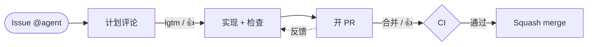

# gh-issue-killer

[English](README.md)

监听 GitHub issue，让编码 agent（opencode、Claude Code 或 Codex）自己完成
计划 → 实现 → 测试 → 截图 → 开 PR → squash merge，全程由 issue 评论驱动。

## 工作流程



本地检查和 PR 上的 CI 检查失败会自动修，轮次用完才停在 `blocked`；关闭 issue 会
取消任务并关掉 PR，重新打开会接着做。

## 解决什么问题

- **issue 堆着没人动。** 读需求、写计划、实现、验证占掉整块时间，PR 一直挂着。
- **PR 的检查和冲突要人盯。** CI 变红、job 卡在已下线的 runner、分支冲突，都要你手动
  查、手动修。
- **agent 直接改工作区太危险。** 改到一半失败或跑到一半断开，工作区就脏了。
- **仓库一多就互相堵。** 一个慢 CI 占住所有任务，只能给每个仓库再开一个 daemon。

## 它能做什么

- **先计划，再动手。** 先发一条计划评论，批准前不写代码；带 `bug` 标签的 issue
  直接复现、修复并补回归测试。
- **每个 issue 一个 worktree。** 独立分支、bot 提交作者，永远不碰你的工作区，
  重启后自动续跑。
- **自己验证、自己修 CI。** 编码 agent 写下 `checks.json`，daemon 负责跑；失败、
  CI 变红或卡住都回到 agent 手里，轮次用完才停在 `blocked`。
- **一条评论驱动全程。** 批准、改 PR、解冲突、合并、取消都是评论或 👍；
  任何被监听仓库的 PR 都能交给它。
- **多仓库、互不阻塞。** 每个仓库有自己的 agent、model、approvers 和队列，
  一个慢仓库堵不住别的。
- **单个静态二进制。** 只发起出站 HTTPS，运行时只需要 `git`、一个编码 agent
  CLI 和 `/bin/sh`。

配置 `webPort` 后还能打开实时看板：每个仓库的队列、阶段进度、PR、检查和截图。

## 用编码 agent 安装

把仓库交给 Claude Code、Codex 或 opencode，然后把下面这段贴进去：

```text
按照 DEPLOY.md 第 0–5 节在这台机器上部署 gh-issue-killer（除非我要求开机自启，
否则跳过第 6 节）。自主完成，最多问我一个问题，且只在这个值确实无法推断时才问。

默认值，不用确认：
- 监控仓库：当前 checkout 的 origin remote；如果没有就问我一次
- approver：`gh api user --jq .login` 得到的我的 GitHub 登录名
- codingAgent：PATH 里第一个 opencode、claude、codex
- model：留空（CLI 默认）
- proxy：设置了 $https_proxy 或 $ALL_PROXY 就用它，否则直连
- 二进制：~/.local/bin/gh-issue-killer
- 配置：~/.config/gh-issue-killer/config.json

不要创建 GitHub 账号或 token。允许用我的 gh 把上面这些仓库的权限授给这个 bot
（DEPLOY.md 第 2 节）。如果没有 gh-agent 凭据（~/.config/gh-agent 或
$GH_AGENT_TOKEN），打印出我需要执行的那一条命令后停下，然后从第 2 节继续。

最后执行第 10 节的检查，把状态行贴出来。不要让我确认你能自己验证的步骤。
```

agent 会按 [DEPLOY.md](DEPLOY.md) 安装二进制、按需创建 `gh-agent`
wrapper、写配置、跑冒烟测试、启动 daemon，并回报状态。它只会在需要 bot token
（这一步只能你本人登录）时停下来。

**手动安装。** 依赖：Go 1.27+、`git`、一个编码 agent CLI，以及一个有 token 的
GitHub bot 账号（`GH_AGENT_TOKEN` 或 `~/.config/gh-agent/hosts.yml`）。

```bash
go build -o bin/gh-issue-killer ./cmd/gh-issue-killer
./bin/gh-issue-killer -init      # 向导：仓库、agent、approvers、代理
./bin/gh-issue-killer            # 后台 daemon
./bin/gh-issue-killer -status    # pid、配置、日志和状态路径
```

完整的部署、运维、升级和排障见 [DEPLOY.md](DEPLOY.md)；内部实现、状态机、队列
和 CI 门禁见 [DEVELOP.md](DEVELOP.md)，贡献/agent 规则见 [AGENTS.md](AGENTS.md)。

## 日常使用

新建一个 @ 了 bot（或 assign 给 bot）的 issue，然后：

| 评论 | 效果 |
| --- | --- |
| `@agent lgtm`、`@agent continue`、`@agent 继续` | 批准计划（或 blocked 后重试） |
| `@agent 合并`、`@agent merge`、`@agent ship` | squash merge PR，关 issue + PR，清理 worktree |
| `@agent review`、`@agent cr`（在 PR 上） | 审查这个 PR 的 diff，发表总结 + 行内意见 |
| `@agent <指令>`（在 PR 上） | 直接改这个 PR：agent 改代码、跑检查，把提交推到 PR head |
| `@agent apply`、`@agent 应用`（在 PR 上） | 直接按最近一次 review 的意见修改，不再重跑 review |
| `@agent 合并`、`@agent merge`（在 PR 上） | 自动解冲突、跑检查和 CI，然后 squash merge 这个 PR |
| `@agent cancel`、`@agent stop`、`@agent 停止` | 中止当前任务 |
| plan 评论上的 👍 | 等同 `@agent lgtm` |
| PR 公告评论上的 👍 | 等同 `@agent 合并` |
| bot 那条「Review 已提交」评论上的 👍 | 按这条 review 的意见直接改 PR 并推送 |

命令必须来自 approver、@ 了 agent，并且**整条评论就是命令**。批准词、状态标签
和 review 的完整规则见 [DEPLOY.md](DEPLOY.md) 和 [DEVELOP.md](DEVELOP.md)。

## 配置

```bash
./bin/gh-issue-killer -init      # 向导：仓库、agent、approvers、代理
```

`-init` 会写好配置；手写就是同样的 `repos` / `codingAgent` / `approvers` /
`proxy` 字段。完整配置项（`language`、`webPort`、每仓库覆盖、保存即重载）见
[DEPLOY.md](DEPLOY.md#41-configuration-reference)。

## 开发

```bash
go test ./...
go build -o bin/gh-issue-killer ./cmd/gh-issue-killer
```

内部实现和发版（打 `v*` tag）见 [DEVELOP.md](DEVELOP.md)，贡献规则见
[AGENTS.md](AGENTS.md)。

## License
[MIT](LICENSE)
