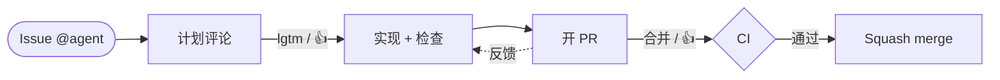
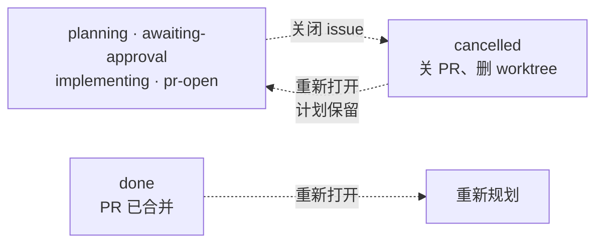

# gh-issue-killer

[English](README.md)

监听 GitHub issue，让编码 agent（opencode、Claude Code 或 Codex）自己完成
计划 → 实现 → 测试 → 截图 → 开 PR → squash merge，全程由 issue 评论驱动。

## 工作流程



本地检查和 PR 上的 CI 检查都会自动修 `maxFixRounds` 轮。CI 变红或卡死（job 排
在已下线的 runner 上、镜像里没有对应 Python 版本）不再停下来等人：agent 会在
同一个 PR 里改 workflow 或改代码，需要维护者审批的 workflow run 会被自动批准；
只有轮次用完才会把 issue 停在 `blocked`，之后用 `@agent 合并` 还能继续。

任何时候关闭 issue 都会取消任务并关掉 PR；重新打开会接着做。已经合并的
issue 被重新打开时，会重新规划。



## 它能做什么

- **先出计划。** 被 @ 或被 assign 后，先在临时 worktree 里生成实现计划并发成
  评论；你批准之前不写任何代码。
- **bug 跳过计划。** 带 `bug` 标签的 issue 直接进入编码阶段：agent 先复现，
  确认存在就修并补回归测试；复现不了就不改代码，直接回报原因、不开 PR。
- **隔离实现。** 每个 issue 一个独立 worktree 和分支，不碰你的工作区；提交
  作者是 bot 账号。
- **自己验证。** 编码 agent 写下证明改动的命令（`checks.json`），daemon 负责
  执行，失败自动让 agent 修 `maxFixRounds` 轮，全过才推送。UI 改动会附前后
  对比截图，裁到改动区域，中间有分隔线。
- **PR 与合并。** 自动开 PR，附上检查和截图，等 CI，收到命令后 squash merge，
  然后关 issue、清理 worktree。检查变红或卡死（比如 runner 标签下线导致一直排队）
  不会停下来等人：agent 会在同一个 PR 里修 workflow 或修代码，等待维护者审批的
  workflow run 会自动批准；只有修复轮次用完才会停在 `blocked`。
- **反馈闭环。** 在已开的 PR 上 @ agent 提非命令类评论、留行内 review 评论或
  review 正文，都会被当作评审意见，在同一个分支继续改。关闭 issue 等于取消并
  关 PR；重新打开会恢复。
- **实时 + 兜底。** webhook 通过 `smee.io` 中转（不需要公网入口），每个事件
  都会先回 GitHub API 复核再执行；没有 hook 权限时自动退化为 30 秒轮询。
- **重启安全。** daemon 重启会从中断的 worktree 自动续跑，不会把 issue 挂起。
- **多仓库、每仓库独立 agent 和队列。** 一个 daemon 监控多个 repo，各自配置
  `codingAgent` / model / approvers，规划和实现队列也相互独立，一个慢仓库不会
  堵住别的仓库。
- **单个静态二进制。** 只发起出站 HTTPS；运行时不需要 `curl`、`ffmpeg`、
  ImageMagick 或 `gh`，只调用 `git`、一个编码 agent CLI 和 `/bin/sh`。
- **实时看板。** 配置 `webPort` 后打开 `http://127.0.0.1:<port>`：每个仓库的
  队列、正在跑的任务、每个 issue 的阶段进度、PR、检查、截图和 daemon 日志，
  都在一块面板里。计划按 markdown 渲染，主题可跟随系统或固定日间/夜间，
  详情里可以直接批准或取消任务。

## 用编码 agent 安装

把仓库交给 Claude Code、Codex 或 opencode，然后把下面这段贴进去：

```text
按照 DEPLOY.md 第 0–5 节在这台机器上部署 gh-issue-killer（除非我要求开机自启，
否则跳过第 6 节）。自主完成，最多问我一个问题，且只在这个值确实无法推断时才问。

默认值，不用确认：
- 监控仓库：当前 checkout 的 origin remote；如果没有就问我一次
- approver：`gh api user --jq .login` 得到的我的 GitHub 登录名
- codingAgent：PATH 里第一个 opencode、claude、codex
- model：留空（CLI 默认）
- proxy：设置了 $https_proxy 或 $ALL_PROXY 就用它，否则直连
- 二进制：~/.local/bin/gh-issue-killer
- 配置：~/.config/gh-issue-killer/config.json

不要创建 GitHub 账号或 token。允许用我的 gh 把上面这些仓库的权限授给这个 bot
（DEPLOY.md 第 2 节）。如果没有 gh-agent 凭据（~/.config/gh-agent 或
$GH_AGENT_TOKEN），打印出我需要执行的那一条命令后停下，然后从第 2 节继续。

最后执行第 10 节的检查，把状态行贴出来。不要让我确认你能自己验证的步骤。
```

agent 会按 [DEPLOY.md](DEPLOY.md) 安装二进制、按需创建 `gh-agent`
wrapper、写配置、跑冒烟测试、启动 daemon，并回报状态。它只会在需要 bot token
（这一步只能你本人登录）时停下来。

**手动安装。** 依赖：Go 1.27+、`git`、一个编码 agent CLI，以及一个有 token 的
GitHub bot 账号（`GH_AGENT_TOKEN` 或 `~/.config/gh-agent/hosts.yml`）。

```bash
go build -o bin/gh-issue-killer ./cmd/gh-issue-killer
./bin/gh-issue-killer -init      # 向导：仓库、agent、approvers、代理
./bin/gh-issue-killer            # 后台 daemon
./bin/gh-issue-killer -status    # pid、配置、日志和状态路径
```

完整的部署、运维、升级和排障见 [DEPLOY.md](DEPLOY.md)。

## 日常使用

新建一个 @ 了 bot（或 assign 给 bot）的 issue，然后：

| 评论 | 效果 |
| --- | --- |
| `@agent lgtm`、`@agent continue`、`@agent 继续` | 批准计划（或 blocked 后重试） |
| `@agent 合并`、`@agent merge`、`@agent ship` | squash merge PR，关 issue + PR，清理 worktree |
| `@agent cancel`、`@agent stop`、`@agent 停止` | 中止当前任务 |
| plan 评论上的 👍 | 等同 `@agent lgtm` |
| PR 公告评论上的 👍 | 等同 `@agent 合并` |

流程用两个标签表示状态：`agent:working` 表示 agent 正在规划、实现或合并（你
不用管），`agent:awaiting-approval` 只在确实需要你操作时出现。批准（评论或 👍）
后会立刻摘掉待确认标签，即使实现任务还在排队等前一个 issue 跑完。

批准时可以带指令：`@agent ok 用 Android 模拟器测试一下`，会直接进入实现，并把
后半句作为附注交给编码 agent。批准词只有 `ok`、`okay`、`lgtm`、`go`、
`continue`、`yes`、`approve`。

命令必须来自 approver、@ 了 agent，并且**整条评论就是命令**——「把按钮合并到
input-group 里」不会触发合并。其他 @ 了 agent 的评论会被当作反馈。daemon
重启会自动续跑；agent 不会响应自己发的评论，也不会响应自己创建的 issue。

## 配置

`-init` 会生成下面的结构，手写也一样：

```json
{
  "repos": ["your-org/app", "your-org/api"],
  "codingAgent": "opencode",
  "approvers": ["your-login"],
  "proxy": ""
}
```

`codingAgent` 可选 `opencode`、`claude`、`codex`。`approvers` 是允许给 bot
下指令的人类账号，不要把 bot 自己写进去。`proxy` 支持 `socks5h://`、
`socks5://`、`http://`、`https://`，同时作用于 API 和 git。

完整配置项、按仓库覆盖以及各 agent 的调用方式见
[DEPLOY.md](DEPLOY.md#41-configuration-reference)。

daemon 用系统文件通知（inotify / kqueue）监听这个文件：保存一份合法配置后，会在
当前任务结束后原地重载（PID 不变）；写错的配置只记录日志，不影响正在运行的实例。

## 开发

```bash
pre-commit install    # 每次提交跑 gofmt、vet、test、build 和 1 MB 大文件检查
go test ./...
```

发布：打一个 `v*` tag（例如 `git tag v0.1.0 && git push --tags`），GitHub
Actions 会跑测试、交叉编译 linux/darwin 的 amd64+arm64 包、注入版本号，并把
压缩包和校验和发布到 GitHub Release。prompts 已内嵌进二进制，压缩包可直接运行。

## License
[MIT](LICENSE)
