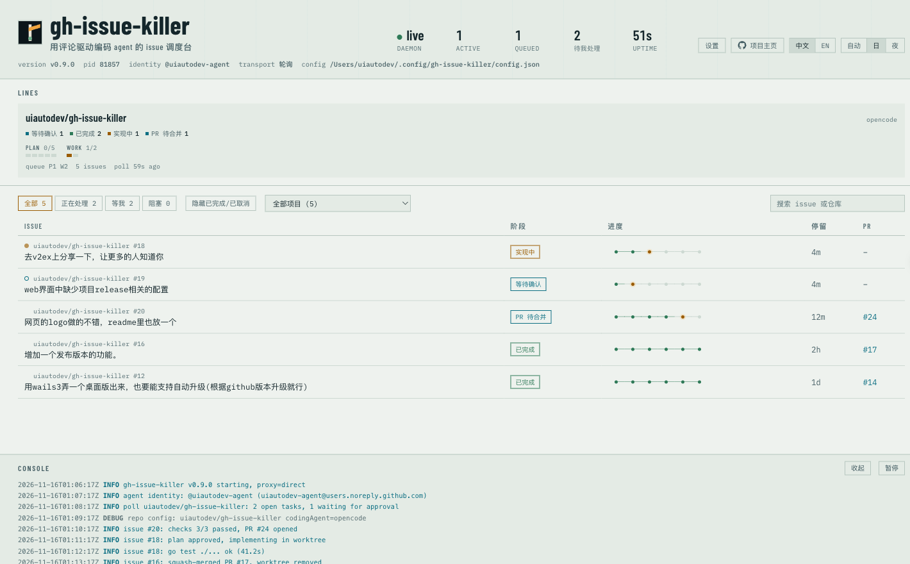
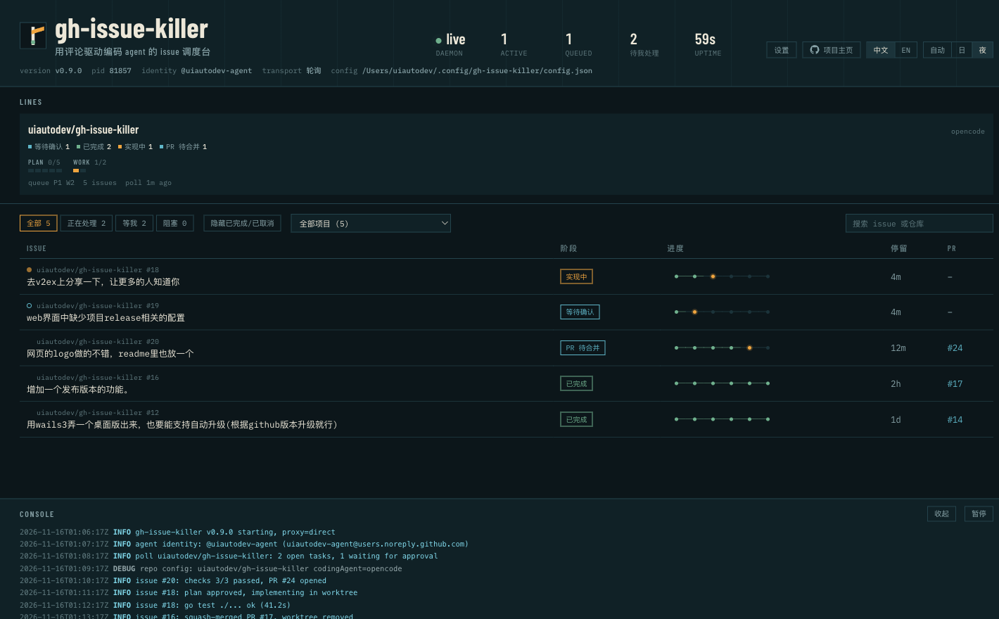

# V2EX 发帖草稿

> 状态：维护者已确认文案（2026-11-16），但尚未发布。自动流程没有 V2EX 登录态，
> 无法代发；请维护者登录后按文末清单手动发布。新账号可能受节点权限和发帖天数限制。

## 标题

把 GitHub issue 交给编码 agent：一条评论走完计划、实现、CI 和合并

## 节点

分享创造

## 正文

issue 堆着没人动，PR 的检查又要一直盯——这两件事占掉的时间，往往比写代码本身还多。
于是我写了个小工具 [gh-issue-killer](https://github.com/uiautodev/gh-issue-killer)，
把这段流程交给编码 agent，自己只用评论控制节奏。

它不是“让 AI 直接改 master”。正常流程是这样：

1. 在 issue 里 @ 一下 bot（或者把 issue assign 给它）。agent 先读仓库、写计划，发
   一条计划评论；批准之前不碰代码。带 `bug` 标签的 issue 跳过计划，直接复现、修复、
   补回归测试。
2. 回 `@bot lgtm`（`continue`、`继续` 也行），或者给计划评论点个 👍。它在同一个
   worktree 里开始实现，写完自己跑 `checks.json` 里的命令，失败就把输出回给 agent 修。
3. 检查过了就开 PR，body 带 `Closes #n`。之后 CI 变红、job 卡住、分支冲突，daemon
   都会自己处理；回 `@bot 合并` 或给 PR 公告评论点 👍，它会再跑一遍检查、过 CI，
   然后 squash merge、关 issue、清 worktree。

三个我觉得最有用的点：

- **先出计划再动手。** 计划就是一条普通评论，你可以直接在上面补充或修改需求；批准
  之前不会写一行代码。这是刻意留的刹车。
- **每个 issue 一个独立 worktree。** 独立分支、bot 作者提交，永远不碰你的工作区；
  daemon 重启后会接着上次的阶段跑。
- **自己验证、自己修 CI。** 编码 agent 写下检查命令，daemon 负责执行；PR 上的 checks
  红了就回去读日志修，轮次用完才停下来等你。





*看板：上面是各仓库的队列余量和并发表，下面是每个 issue 的阶段、检查进度和 PR。
截图使用示例数据。*

## 跑起来需要什么

- Go 1.27+ 和 `git`，也可以直接用 [Releases](https://github.com/uiautodev/gh-issue-killer/releases)
  里的二进制
- 一个编码 agent CLI：opencode、Claude Code 或 Codex
- 一个独立的 GitHub bot 账号和它的 token（`GH_AGENT_TOKEN` 或
  `~/.config/gh-agent/hosts.yml`）
- 只支持 GitHub；运行时只发起出站 HTTPS，不需要开任何入站端口

边界也说清楚：计划和合并默认要人批准，不是“全自动写代码然后自己合”；daemon 不会去用
你本机的 `gh auth token`；单用户单实例运行。macOS、Linux、Windows 都能跑，Windows
上也可以直接用桌面版，关窗即停。

## 安装

最省事的是把仓库交给 Claude Code、Codex 或 opencode，让它按 `DEPLOY.md` 自己装。
仓库里有一段现成的 prompt，原样贴进去：

```text
按照 DEPLOY.md 第 0–5 节在这台机器上部署 gh-issue-killer（除非我要求开机自启，
否则跳过第 6 节）。自主完成，最多问我一个问题，且只在这个值确实无法推断时才问。

默认值，不用确认：
- 监控仓库：当前 checkout 的 origin remote；如果没有就问我一次
- approver：`gh api user --jq .login` 得到的我的 GitHub 登录名
- codingAgent：PATH 里第一个 opencode、claude、codex
- model：留空（CLI 默认）
- proxy：设置了 $https_proxy 或 $ALL_PROXY 就用它，否则直连
- 二进制：~/.local/bin/gh-issue-killer
- 配置：~/.config/gh-issue-killer/config.json

不要创建 GitHub 账号或 token。允许用我的 gh 把上面这些仓库的权限授给这个 bot
（DEPLOY.md 第 2 节）。如果没有 gh-agent 凭据（~/.config/gh-agent 或
$GH_AGENT_TOKEN），打印出我需要执行的那一条命令后停下，然后从第 2 节继续。

最后执行第 10 节的检查，把状态行贴出来。不要让我确认你能自己验证的步骤。
```

agent 会按 [DEPLOY.md](https://github.com/uiautodev/gh-issue-killer/blob/master/DEPLOY.md)
安装二进制、按需创建 `gh-agent` wrapper、写配置、跑冒烟测试、启动 daemon，并回报状态。
它只会停在需要 bot token 的那一步，因为那一步只能你本人登录。

代码是 MIT 协议。用着有问题、或者你的流程跟它不一样，欢迎直接开 issue @ 它自己——
这个项目现在就是这么被开发出来的。

## 发布清单（不要贴进正文）

1. 登录 V2EX 后打开 <https://www.v2ex.com/new>，节点选「分享创造」；标题用上面那段。
2. 正文从「issue 堆着没人动」复制到「这个项目现在就是这么被开发出来的。」，
   不要带本文件的标题、状态说明和这份清单。
3. 图片按顺序上传：先 `docs/images/dashboard-light.png`，再
   `docs/images/dashboard-dark.png`；把正文里的相对路径换成 V2EX 上传后的图片地址。
   如果只想放一张，保留亮色那张并删掉另一行。
4. 发布前逐项自查：
   - 仓库、Releases、DEPLOY.md 三个链接都能打开；
   - 两张图（或保留的那张）能正常显示；
   - 代码块完整，尤其是默认值列表和最后的第 10 节检查；
   - 正文里没有“一键”“全自动”这类夸张表述。
5. 发布后用无痕窗口打开一次，确认未登录也能看到正文和图片。
6. 发帖由维护者账号手动完成；本文件只是草稿，daemon 和 agent 都不会代发。
